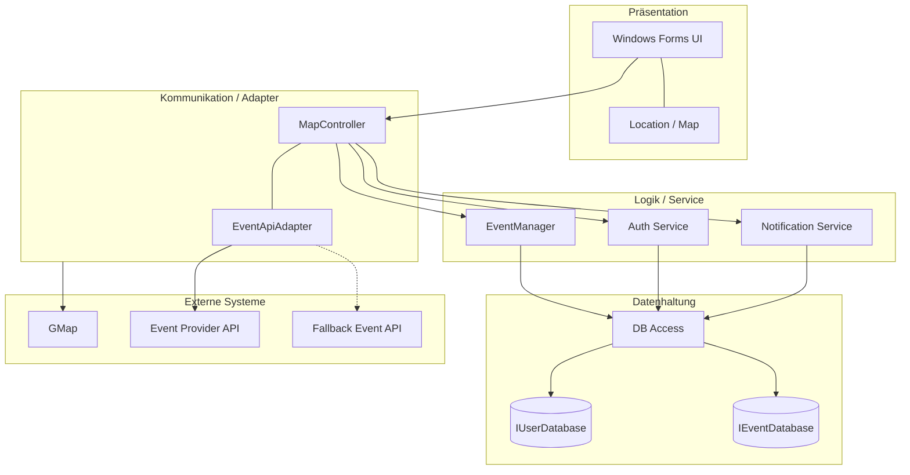

# Event-Map – Interaktive Event-Plattform für Berlin

Desktop-Anwendung in C# (Windows Forms), die Veranstaltungen in Berlin auf einer interaktiven Karte zeigt. Entstanden als Hochschulprojekt an der HTW Berlin.

> Dieses Repository ist eine Projektübersicht. Der Quellcode ist ein Teamprojekt und liegt im internen GitLab der HTW Berlin.

## Funktionen

- **Karte statt Liste:** Events in der Nähe auf einen Blick entdecken und Details abrufen.
- **Eigene Events:** Nutzer:innen können sich registrieren und eigene Veranstaltungen anlegen.
- **Teilnahme:** Anmeldung zu Veranstaltungen direkt in der App.
- **Eine zentrale Quelle:** Event-Daten kommen über eine externe Event-API, mit einer Fallback-API als Ausweichquelle.
- **Benachrichtigungen:** eigener Notification Service in der Logikschicht.

## Tech-Stack

| Bereich | Technologie |
|---|---|
| Sprache / UI | C#, .NET, Windows Forms |
| Karte | GMap (Kartenkomponente) |
| Externe Daten | Event Provider API, Fallback Event API (über Adapter angebunden) |
| Datenhaltung | DB-Zugriffsschicht mit getrennten Interfaces für Nutzer- und Event-Datenbank |

## Architektur

Die Anwendung ist in vier Schichten aufgebaut: Präsentation, Kommunikation/Adapter, Logik/Service und Datenhaltung. Externe Event-Quellen werden über einen Adapter angebunden. Fällt die Haupt-API aus, greift eine Fallback-API.

## Mein Beitrag

Teamprojekt mit 3 Personen. Ich habe die nutzerbezogenen Funktionen umgesetzt:

- **Account:** Registrierung und Login
- **Events erstellen:** Formular und Logik zum Anlegen eigener Veranstaltungen
- **Eigene Events anzeigen:** Übersicht der erstellten Veranstaltungen
- **Event-Anmeldung:** Anmeldung von Nutzer:innen zu Veranstaltungen

## Kontakt

Ahmed Al-Amwi · Student der Ingenieurinformatik (B.Eng.), HTW Berlin
